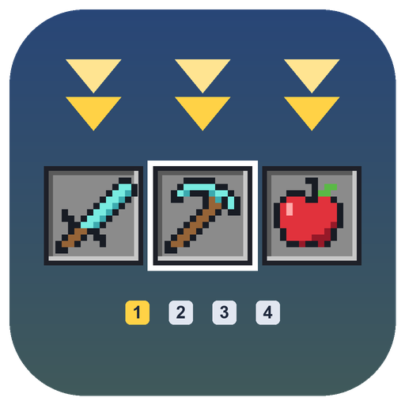

<p align="center">
  
</p>

<h1 align="center">QuickLoadout</h1>

<p align="center">
  Save up to 4 hotbars. Get them back with <b>one key</b>.<br>
  A client-side Fabric mod for Minecraft 1.21.8 - 1.21.11.
</p>

<p align="center">
  <a href="https://modrinth.com/mod/quickloadout"></a>
  <a href="https://discord.gg/KBAjPbwMx"></a>
  
</p>

---

Building, fighting, farming, exploring: each one needs a different hotbar. Set it up once and save it. From then on QuickLoadout pulls the right items out of your inventory and puts each one back in its slot. If something is missing, it tells you exactly what.

| Action | Default keys |
|---|---|
| Save the hotbar to loadout 1-4 | hold **L** + **1 / 2 / 3 / 4** |
| Recall loadout 1-4 | hold **L** + **F1 / F2 / F3 / F4** |


## Features

- **4 loadouts**, saved in `config/quickloadout.json` and shared by every world and server
- **One key recall**: items come from the main inventory, the other hotbar slots and the offhand
- **Full stacks**: split stacks are merged back to the saved amount (30 + 34 cobblestone become 64)
- **Missing items** are listed above the hotbar with their display name and amount: a diamond renamed "diamante" shows up as *diamante*
- **Smart matching**: same item and components (name, enchantments, potions...), ignoring durability, repair cost and container contents. A worn sword is still your sword
- **Works on any server**: only normal inventory clicks, nothing to install server-side
- **Vanilla keys keep working**: F1 still hides the HUD, F3 still opens the debug screen, 1-4 still select slots and a tap of L still opens Advancements
- **Every key can be changed** in *Options → Controls → Key Binds → Hotbar Settings*
- English and Italian, following the game language


## Download

[Modrinth](https://modrinth.com/mod/quickloadout) (requires [Fabric API](https://modrinth.com/mod/fabric-api)).

## FAQ

**Can I use F1-F4 without holding L?**
Yes: set *Recall: Modifier key (hold)* to *Not bound*. F1-F4 then always recall loadouts and no longer hide the HUD or open the debug screen.

**Does it throw my items away?**
No. Empty slots in a loadout are left as they are, and items are only swapped around inside your inventory.

**Does it work while a screen is open?**
No, saving and recalling only work in game, so typing in chat is never affected.

## Building

Requires JDK 21.

```
./gradlew build
```

The jar is created in `build/libs/`.

## License

[MIT](LICENSE)
