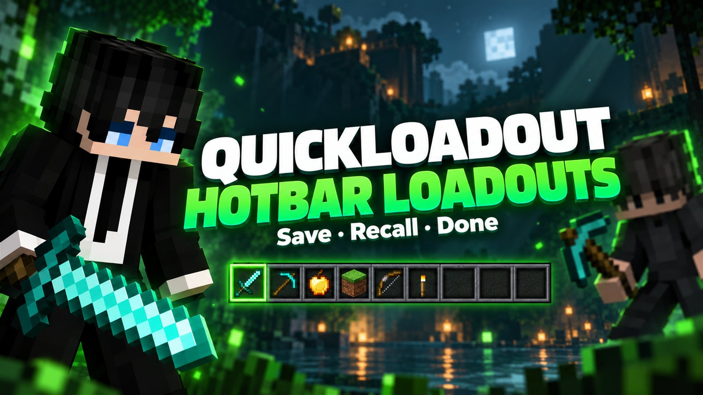
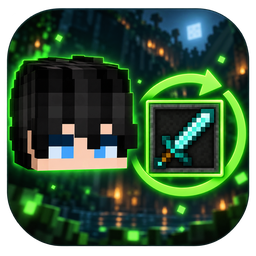
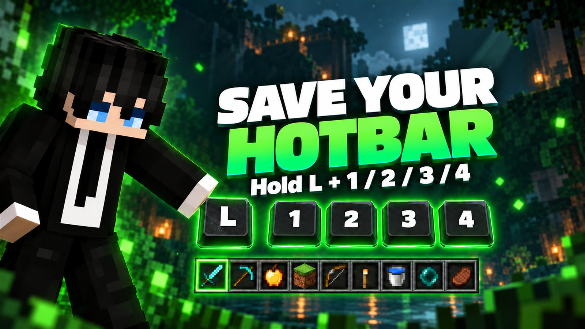
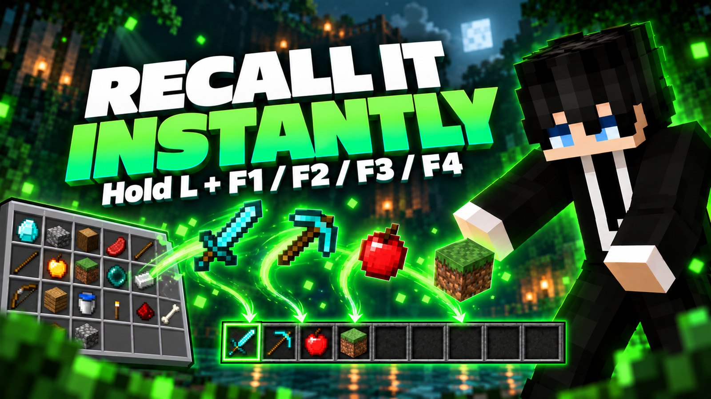
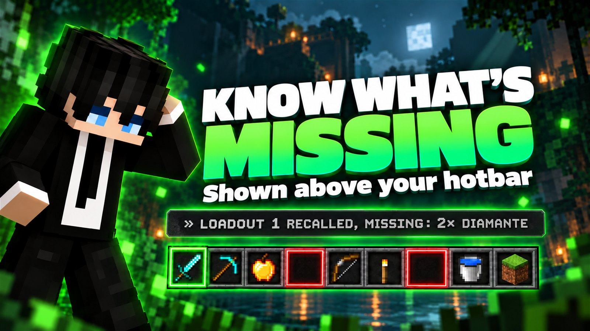
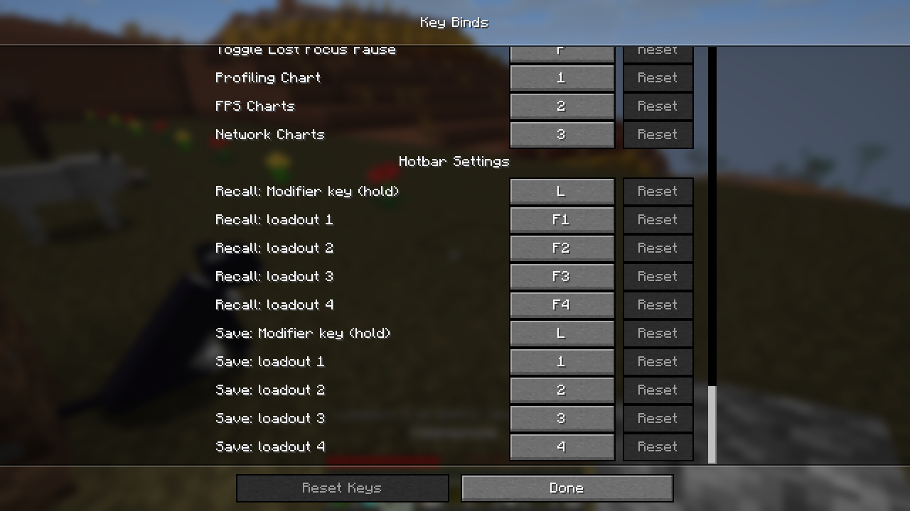
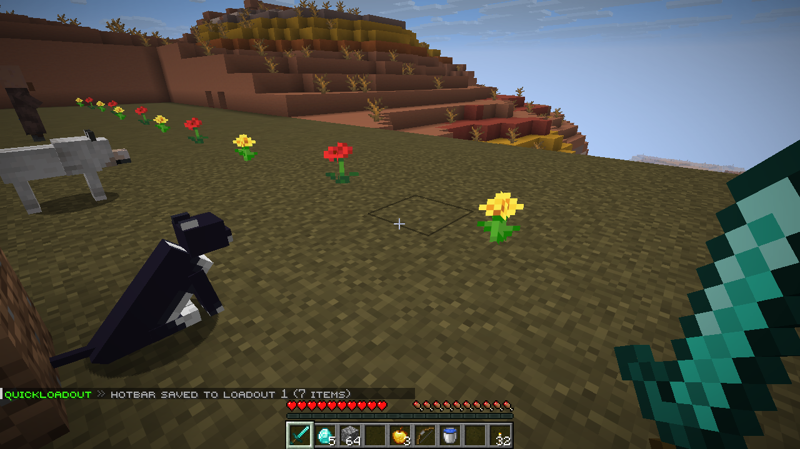
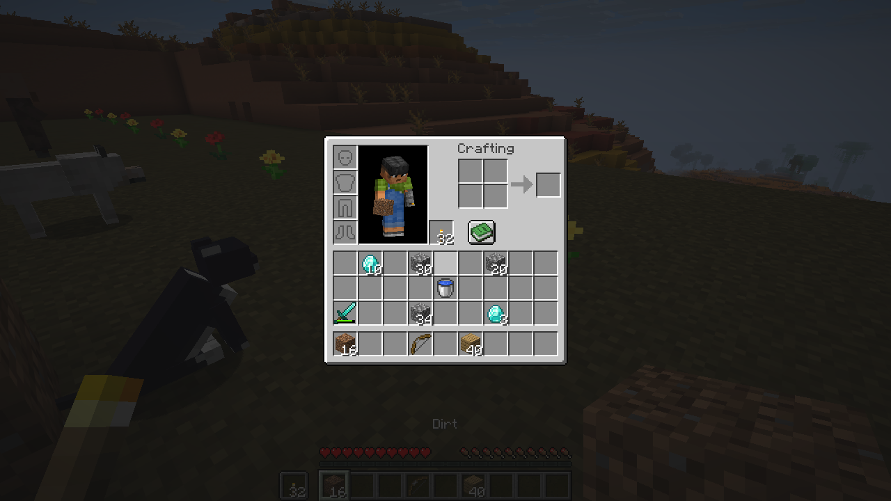
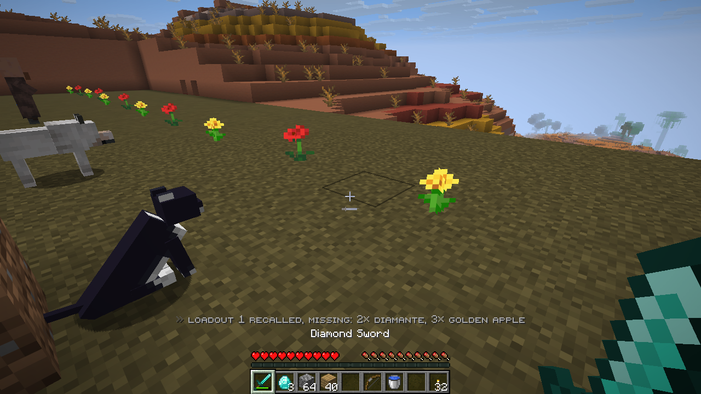
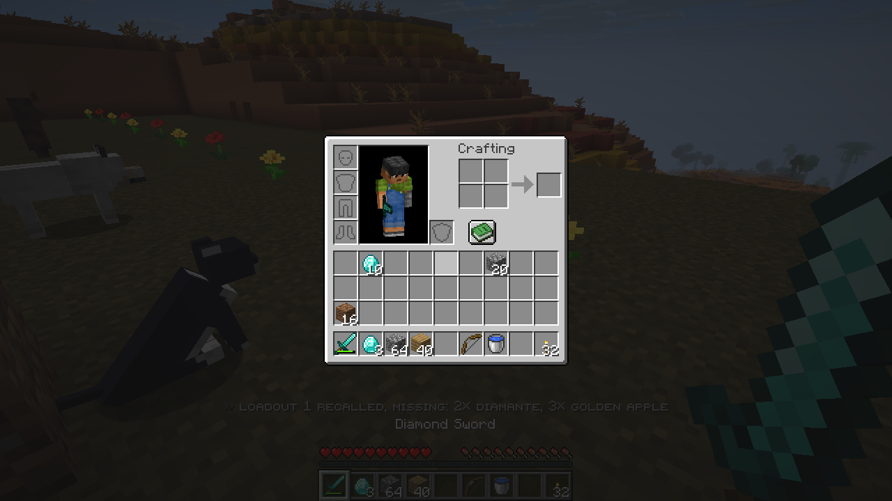

<p align="center">
  
</p>

<p align="center">
  <br>
  <b>Save up to 4 hotbars. Get them back with one key.</b><br>
  A client-side Fabric mod for Minecraft 1.21.8 - 1.21.11.
</p>

<p align="center">
  <a href="https://modrinth.com/mod/quickloadout"></a>
  <a href="https://discord.gg/KBAjPbwMx"></a>
  
  
  
</p>

<p align="center">
  <a href="#-save-your-hotbar">Save</a> ·
  <a href="#-recall-it-instantly">Recall</a> ·
  <a href="#-know-whats-missing">Missing items</a> ·
  <a href="#-keys">Keys</a> ·
  <a href="#-faq">FAQ</a> ·
  <a href="https://modrinth.com/mod/quickloadout">Download</a>
</p>

---

Building, fighting, farming, exploring: each one needs a different hotbar. Set it up once and save it. From then on QuickLoadout pulls the right items out of your inventory and puts each one back in its slot. If something is missing, it tells you exactly what.

## 💾 Save your hotbar



Hold **L** and press **1**, **2**, **3** or **4**. The whole hotbar is saved to that loadout, with names, enchantments and every other detail of each item.

Loadouts live in `config/quickloadout.json` and are shared by every world and server.

## ⚡ Recall it instantly



Hold **L** and press **F1**, **F2**, **F3** or **F4**. Every item is pulled from your main inventory, the other hotbar slots or the offhand and dropped into its saved slot.

- **No fixed amounts:** saved 28 bread and ate 2? The 26 you have go back in the slot
- **Empty slots stay empty:** slots that were empty when you saved are cleared into your inventory
- **Smart matching:** the identical item first, then the same item ignoring durability and similar, then the same item with the same name. A worn sword is still your sword, and server items like guns with changing ammo or lore are still found
- **Works on any server:** it only uses normal inventory clicks, the same a player makes by hand. Nothing to install on the server

## 📝 Know what's missing



Items you don't have at all are listed right above your hotbar with their **real display name**. A diamond renamed *"diamante"* shows up as *diamante*, not as *Diamond*, and never gets replaced by a plain one.

The chat stays clean: it is only used when you save a loadout.

## 🎹 Keys

| Action | Default keys |
|---|---|
| Save the hotbar to loadout 1-4 | hold **L** + **1 / 2 / 3 / 4** |
| Recall loadout 1-4 | hold **L** + **F1 / F2 / F3 / F4** |

Every key can be changed from the **QuickLoadout Settings...** button in the Options screen, or in **Controls → Key Binds → Hotbar Settings**.

QuickLoadout is careful with the keys vanilla already uses:

- **F1** still hides the HUD and **F3** still opens the debug screen: the F keys only recall a loadout while L is held
- **1-4** still select the hotbar slots when L is not held
- A quick **tap of L** still opens Advancements

<p align="center">
  
</p>

## 🎮 In game

<table>
  <tr>
    <td></td>
    <td></td>
  </tr>
  <tr>
    <td align="center">Hotbar saved</td>
    <td align="center">A messy inventory</td>
  </tr>
  <tr>
    <td></td>
    <td></td>
  </tr>
  <tr>
    <td align="center">One key later</td>
    <td align="center">Everything back in place</td>
  </tr>
</table>

## ❓ FAQ

<details>
<summary><b>Can I use F1-F4 without holding L?</b></summary>

Yes: set *Recall: Modifier key (hold)* to *Not bound* (press Esc while changing it). F1-F4 then always recall loadouts and no longer hide the HUD or open the debug screen.
</details>

<details>
<summary><b>Can it lose my items?</b></summary>

No. Items are only moved around inside your inventory. Slots saved empty are cleared into the inventory, and if it is full they are left as they are: nothing is ever dropped.
</details>

<details>
<summary><b>Does it work on servers?</b></summary>

Yes, on vanilla, Paper, Spigot and any other server. It only sends normal inventory clicks and needs nothing on the server.
</details>

<details>
<summary><b>Does it work while a screen is open?</b></summary>

No, saving and recalling only work in game, so typing in chat or using the inventory is never affected.
</details>

<details>
<summary><b>Which languages are supported?</b></summary>

English and Italian. Messages follow the game language.
</details>

## 📥 Download

[Modrinth](https://modrinth.com/mod/quickloadout). Requires [Fabric API](https://modrinth.com/mod/fabric-api).

## 🔧 Building

Requires JDK 21.

```
./gradlew build
```

The jar is created in `build/libs/`.

## License

[MIT](LICENSE)
